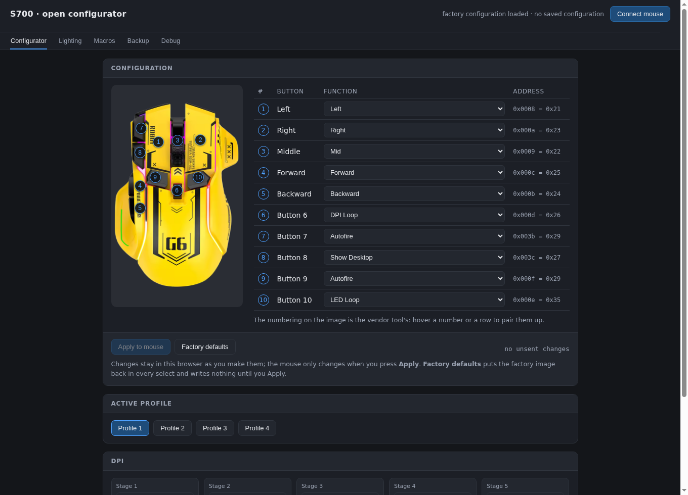
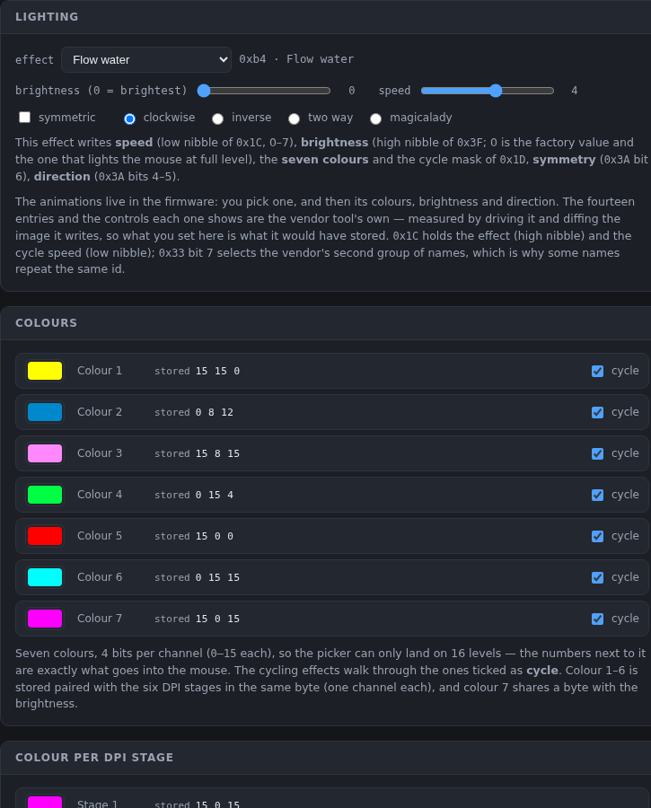

# Configurador libre del ratón HXSJ S700 «G6» — sin drivers, en Linux, Windows o el navegador

[](LICENSE)


[](https://github.com/Jo3l/s700-mouse-configurator/releases/latest)
[](https://github.com/Jo3l/s700-mouse-configurator/releases)

**Read this in English: [README.md](README.md)**

## Descargar y usar en un minuto

| Quiero… | Cómo |
|---|---|
| **usarlo sin descargar nada** | **<https://jo3l.github.io/s700-mouse-configurator/>** — la herramienta servida, con WebHID; abre la página y pulsa *Connect mouse* |
| **Windows** | [`s700-host-windows-x86_64.exe`](https://github.com/Jo3l/s700-mouse-configurator/releases/latest) — doble clic y ya: abre **su propia ventana** (sin pestañas ni barra de direcciones) con la interfaz cargada, y habla con el ratón él mismo; sin permisos ni instalador |
| **Linux, sin instalar nada** | [`S700-configurator-x86_64.AppImage`](https://github.com/Jo3l/s700-mouse-configurator/releases/latest) — un solo fichero: `chmod +x` y a correr; lleva WebKitGTK dentro |
| **Linux** | [`s700-host-linux-x86_64`](https://github.com/Jo3l/s700-mouse-configurator/releases/latest) — ejecútalo; si no puede abrir el ratón te ofrece instalar la regla udev y te pide la contraseña una vez |
| **un solo fichero HTML** | `S700-configurator.html` de la release: se abre con doble clic en Chrome/Edge/Brave, sin servidor |

Los binarios los compila GitHub Actions al publicar cada versión
([`.github/workflows/release.yml`](.github/workflows/release.yml)), y la web se
publica sola en GitHub Pages desde `main`
([`.github/workflows/pages.yml`](.github/workflows/pages.yml)). Antes de escribir en el
ratón, haz una copia en la pestaña *Backup*.

Configurador **libre, sin drivers y sin instalar nada** para el ratón gaming
**HXSJ S700** — el que se vende también como **«G6»** o *S700 Gaming Mouse*, y que
solo trae una herramienta para Windows de 2016 (`S700 Gaming Mouse.exe`, MFC + GDI+,
sin firma). Remapea los **10 botones**, ajusta las **6 etapas de DPI**, crea
**macros**, cambia la **iluminación RGB**, gestiona los **4 perfiles** y guarda
**copias de seguridad** — desde **Linux**, **Windows** o **cualquier navegador
Chromium**, sin el software del fabricante y sin controladores.

El ratón guarda su configuración en memoria propia y habla **informes HID feature**,
así que la herramienta puede ser una página web. Este repositorio es el protocolo
descifrado, un configurador web (WebHID), un host nativo en Rust y las pruebas que
comparan byte a byte con lo que escribe el programa original.



## Qué se puede cambiar

| | |
|---|---|
| **Botones** | los 10 (izquierdo, derecho, rueda, laterales, rueda inclinada, botón de DPI) → 20 acciones: botón, tecla, multimedia, macro, DPI loop, LED loop, autofire, atajos. Una tecla puede **mantenerse mientras se aprieta** (por defecto), ser un toque o tocar mientras se mantiene — hasta 4 teclas mantenidas, el mismo límite que la herramienta del fabricante |
| **DPI** | 6 etapas, hasta 6 colores distintos de LED, un color por etapa |
| **Iluminación** | los **14 efectos** de la herramienta del fabricante, cada uno con los controles que enseña de verdad (velocidad, brillo, 7 colores + casillas del ciclo, simetría, hasta 4 direcciones), 6 colores por etapa (independientes del efecto) y **una animación por botón** para *Button response* |
| **Macros** | nombre + pasos (tecla, botón del ratón, movimiento XY, DPI, retardo), modos de repetición (hasta soltar/click, N veces), hasta 21 pasos, asignables a un botón — comparten con las teclas el bloque de flujos de 192 B del ratón, y la pestaña dice cuánto hay en uso |
| **Perfiles** | 4 perfiles de botones, con el activo a golpe de botón |
| **Backup** | exportar/importar la configuración completa en un JSON; la imagen de fábrica va incluida |
| **Guardado** | todo cambio se guarda solo en el navegador; al ratón solo se escribe cuando pulsas **Apply** |
| **Debug** | dispositivo y regla udev, sonda de bytes, imagen de memoria y volcado hex, el tráfico HID, los tres modos de tecla y una sonda que escribe cuatro formas de tecla en cuatro botones en un solo Apply |



## Tres formas de usar el mismo proyecto

La interfaz es **la misma** en las tres; no hay código duplicado.

| | Permisos | Qué necesitas | Tamaño |
|---|---|---|---|
| **Página web** (`make serve` + Chrome) | diálogo de WebHID por origen + regla udev en Linux | un navegador Chromium | 0 |
| **Un solo fichero HTML** (`make build`) | lo mismo (se abre como `file://`) | un navegador Chromium | ~580 KB |
| **Host nativo** (`make native`) | **nada en Windows**; regla udev en Linux | Windows: nada (WebView2 viene con Edge). Linux: `libwebkit2gtk-4.1-0`, `libgtk-3-0` | ~1.3 MB |
| **AppImage** (`make appimage`) | regla udev en Linux | nada salvo un escritorio (GL y fuentes, que cualquiera tiene) | ~80 MB |

El host nativo (`native/`) es un ejecutable de Rust sin dependencias que lleva la UI
dentro, la sirve en `127.0.0.1` y habla el HID él mismo: no hay WebHID, ni diálogo
de permisos del navegador, ni instalador. La UI se abre en una ventana de aplicación
del Edge/Chrome que ya tengas — sin pestañas ni barra de direcciones — y al cerrar la
ventana el host termina (`--browser` la abre como pestaña normal). En Windows es donde
más se nota — allí no hay que conceder nada.

### Dos pieles sobre la misma interfaz

`make build` escribe **dos** páginas de un solo fichero con el mismo código:

| fichero | aspecto |
|---|---|
| `dist/S700-configurator.html` | la consola normal: cinco pestañas, colores neutros |
| `dist/S700-configurator-eva.html` | piel **ORIEL** táctica: una sola página (sin pestañas — un raíl de kanji salta entre cinco capítulos), marco de telemetría fijo (etiqueta de estado, enlace, reloj, uso de la arena), verde fósforo sobre negro con el morado de la unidad-01 y rojo de alarma, **fondo 3D de malla** (suelo hexagonal + muro de barrera que ondula + núcleo de alambre, WebGL escrito a mano con reserva de lattice 2D), paneles con reglas de 1px y esquinas en L, franjas de riesgo, un **capítulo en rojo** para las macros (marquesina, acentos de alarma, entrada «snap cutting»), la **propia sección `#alert`** del diseño, flotando a todo el ancho y centrada, como aviso de cada guardado/aplicado — reducida a media pantalla (la banda de la marquesina intacta, todo lo de debajo en una línea) con **las ocho regiones de la imagen encendiéndose una tras otra** mientras se escribe; la barra de progreso del clásico aquí no se usa, la lista de botones como el **rib-layout** del diseño (una costilla por botón — placa con el número, nombre, selector de función y dirección sobre una espina naranja central, foto y costillas en la misma fila), y un **select propio** (el nativo queda oculto como fuente de verdad) con el valor en el naranja del componente, control con borde y un panel de opciones normal agrupado por `<optgroup>` |

Comparten `web/app.js`, el protocolo y todos los ids, así que una función va en las dos o en
ninguna; `make build-eva` compila sólo la segunda y `make test` valida ambas
(`tools/test_ui_eva.mjs` comprueba que la página nueva trae todos los controles que pide app.js).
La piel conserva las pilas tipográficas del diseño con sustituto del sistema y dibuja el
lattice del fondo en un canvas 2D, así que el fichero único sigue funcionando sin red y sin CDN.

## Empezar

### Windows

```powershell
s700-host.exe            # doble clic: abre su propia ventana con la interfaz cargada
```

o coge `dist/S700-configurator.html`, ábrelo con doble clic en Chrome/Edge/Brave y
pulsa **Connect mouse**. Cierra antes la herramienta del fabricante y su bandeja: la
abren en exclusiva y el ratón no se deja.

### Linux

```bash
make native && ./native/target/release/s700-host          # o: make native-run
./native/target/release/s700-host --list                  # ¿ve el ratón?
./native/target/release/s700-host --install-rule           # sólo si no puede abrirlo
```

El nodo `/dev/hidraw*` es `0600 root:root` en el kernel, así que alguien tiene que
dar acceso — el navegador también lo necesita. El binario no te manda copiar nada: si
no puede abrir el ratón lo dice y se ofrece a instalar la regla, desde la pestaña
*Debug* (**Install udev rule**) o con `--install-rule`. Tu escritorio pide la
contraseña una vez (`pkexec`) y a partir de ahí todo corre como tu usuario normal.

Lo que **no** hace, a propósito, es ejecutar el servidor como root: funcionaría sin
regla, pero dejaría un servidor HTTP local con acceso al dispositivo corriendo como
root. Una regla udev atada a un VID:PID es una puerta mucho más pequeña.

### Navegador, sin instalar nada

```bash
make build       # genera dist/S700-configurator.html
make serve       # o servir la versión con módulos en http://localhost:8099/web/
```

Solo navegadores con **WebHID**: Chrome, Edge, Brave, Opera, Vivaldi o Arc.
Firefox y Safari no lo implementan.

### macOS

La página web funciona en Chrome (WebHID); el host nativo aún no está portado.

## Compatibilidad

* **HXSJ S700 con cable** — `VID:PID 30FA:1540`, informe feature **id 7 de 64 bytes**,
  colección vendor `0xFF00/0x01`. Es la unidad con la que se ha medido todo.
* El ratón solo escribe: **no contesta a `GetFeature`** (`docs/PROTOCOL.md` §4), así
  que la configuración de partida es la imagen de fábrica leída del software original.
* Sin probar: la variante inalámbrica, otras revisiones de firmware del mismo modelo.
  Si tu unidad no aparece, `--list` y el panel *Debug* dicen qué se ve.

## Preguntas frecuentes

**¿Funciona sin el programa del fabricante?** Sí: es exactamente lo que hace. No
hace falta instalarlo, ni Wine, ni Windows.

**¿Necesito permisos de administrador?** En Windows no. En Linux hay que dar acceso
al nodo del kernel una vez (regla udev incluida); sin eso no hay forma, ni con
navegador ni con binario.

**¿Puede dejar el ratón inservible?** No hay caso conocido: la configuración es
memoria flash aparte del firmware. Aun así, **haz una copia antes** (pestaña
*Backup*) y ten a mano la herramienta del fabricante; volver a escribir una
configuración conocida lo deja como estaba.

**¿Existen los 14 efectos de luz?** Sí, y la lista de la herramienta es honesta. Conducida
entrada por entrada, escribe 14 ajustes distintos: los ids 8–15 para los ocho primeros
nombres, otra vez los ids 8–11 pero con el bit 7 de `0x33` puesto para el segundo grupo
(Flicker, Star Trek, Water, enraptured), el id 9 con el nibble del ciclo a 12 para *Button
response* y a 7 para *Mute*. Lo que **no** se ha hecho es verlos todos en el LED: los
medidos son los de la configuración de fábrica (Star Trek, o sea 9 + ese bit) — 8 parpadea,
9 deja el color fijo, 10 respira y 11 recorre la tira — y con ese byte los ids 12–15 no
encendían. El configurador ofrece los catorce con las opciones que enseña el fabricante, y
la sonda de bytes del panel Debug es la forma de comprobar el resto
(`docs/PROTOCOL.es.md` §5-quater).

**¿Cómo se averiguó el protocolo?** Ingeniería inversa del `.exe` y captura del
tráfico HID real, ejecutando la herramienta original bajo Wine con una DLL que
suplanta `HID/SetupAPI`. Todo el arnés está en `tools/`.

**¿Se puede mantener una tecla con un botón?** Sí, y es lo que hace por defecto una tecla asignada
a un botón: aprietas el botón y la tecla se queda abajo —con el auto-repeat del sistema, como una
tecla de verdad— y al soltarlo sube. Es la forma de la propia herramienta del fabricante (`0x2E` +
veinte `81 <tecla>`); el configurador antes aparta la biblioteca de macros, que es lo que hacía que
se quedara en un toque de 1 ms (`docs/PROTOCOL.es.md` §5-ter). En *Debug → Keyboard keys → on
press* se cambia a *tap once* o *tap while held*.

**¿Cuántas teclas puedo poner en los botones?** Cuatro si se mantienen (42 B cada una en el bloque
de 192 B, el mismo límite que el fabricante), las diez si solo tocan y ocho si tocan mientras se
mantiene. Lo que no cabe se queda sin tocar y la tabla de botones lo dice.

**¿Hace falta internet?** No: ninguna de las tres formas sale de tu equipo.

**¿Y el teclado/software propio del ratón (autofire, DPI loop)?** Las 20 acciones del
firmware están soportadas; son las que trae el propio ratón.

## Documentación

* **[docs/PROTOCOL.es.md](docs/PROTOCOL.es.md)** — protocolo y mapa de memoria, con lo
  verificado y lo que falta (la versión inglesa, la de por defecto, es `docs/PROTOCOL.md`).
* **[docs/NATIVE.es.md](docs/NATIVE.es.md)** — el host nativo: cómo encaja, permisos,
  compilación y qué queda por probar.

## Estado

| Pieza | Estado |
|---|---|
| Protocolo (tramas, comandos, bloques de escritura) | verificado contra el programa original |
| Mapa de botones y perfiles | verificado byte a byte |
| Tabla de acciones (1–20) | verificada |
| DPI (empaquetado en nibbles) | verificado; la correspondencia con el DPI real está pendiente |
| LED | **descifrado**: los 14 efectos de la lista del fabricante (id en `0x1C`, segundo grupo en el bit 7 de `0x33`, *Button response*/*Mute* en el nibble del ciclo), las opciones que escribe cada uno (velocidad `0x1C`, brillo `0x3F`, 7 colores + máscara `0x1D`/`0x20–0x31`, simetría y 4 direcciones en `0x3A`), canales de 4 bits con el **nivel invertido**, y la **animación por botón** en los bits 7–6 del byte de acción de cada botón. Visto en hardware: sólo los ids de fábrica; si simetría/dirección cambian la animación sigue **sin confirmar** |
| Macros y teclas | **verificado en el ratón**: el área de macros (arena de `0x400` + biblioteca de macros, que hay que subir a `0x4C0` antes de escribir), el registro de ranura, los formatos de flujo, los tres modos de tecla (una tecla en un botón **se mantiene** mientras se aprieta) y el editor de 21 pasos |
| Lectura (`GetFeature`) | probada en hardware y no devuelve el protocolo: la base es la imagen de fábrica |
| Tamaño de informe (64 bytes de datos) | confirmado en el ratón real |
| Escritura | siempre la **imagen completa** (132 bloques), como el fabricante; escribir solo los bloques tocados hace que el ratón descarte el cambio |
| Host nativo | Linux compilado y probado hasta la escritura (bloqueada por permisos del nodo); `.exe` de Windows compilado, **sin probar en Windows** |
| CLI de Python | funciona contra backups; falta probar con el ratón real |

## Cómo habla el ratón (resumen)

```
informe feature id 7, 64 bytes de datos (colección 0xFF01)
18 <cmd> <idx> <addr_lo> <addr_hi> <dato> <len-1> ...

cmd 03 = escribir byte (idx = posición)   cmd 05 = leer byte
cmd 09 = confirmar bloque en <addr>       cmd 00 = fin   cmd 10 = fin de sesión
```

El programa del fabricante sube la configuración en bloques de 8 bytes y usa **solo**
`HidD_SetFeature`/`HidD_GetFeature`. Detalle completo en
[docs/PROTOCOL.es.md](docs/PROTOCOL.es.md).

La imagen lleva además el **área de macros** (`0x400–0x567`): 192 B de flujos para los botones y,
justo encima, la biblioteca de macros del fabricante. Esa biblioteca hay que subirla a `0x4C0`
antes de escribir un flujo de botón —la imagen de fábrica la tiene en `0x400`, y ese choque es lo
que convertía una tecla mantenida en un toque de 1 ms (`docs/PROTOCOL.es.md` §5-ter).

## CLI de backup y ajustes

```bash
pip install hidapi
python tools/g6cli.py list
python tools/g6cli.py dump mi-raton.json     # copia + resumen (root en Linux)
python tools/g6cli.py show mi-raton.json
python tools/g6cli.py set-key 8 20           # botón 8 -> acción 20
python tools/g6cli.py set-profile 2
python tools/g6cli.py restore mi-raton.json
```

## Desarrollo

```bash
make serve     # http://localhost:8099/web/index.html
make build     # dist/S700-configurator.html + dist/S700-configurator-eva.html
make build-eva # sólo la piel EVA-01
make native    # native/target/release/s700-host
make test      # 309 comprobaciones
```

Las pruebas reproducen bytes capturados del programa original
(`tools/probe/baseline.log`), así que si el ratón cambia de protocolo lo detectan.
Para probar la interfaz sin hardware está `tools/mock_hid.js` (ratón simulado).

## Estructura

```
dist/                S700-configurator.html — un solo fichero, doble clic
docs/PROTOCOL.md     protocolo y mapa de memoria (inglés; español en .es.md)
docs/NATIVE.md       host nativo: diseño, permisos y compilación (inglés)
web/                 configurador WebHID (g6.js protocolo, core.js lógica, app.js UI)
web/bridge.js        enchufe que sustituye navigator.hid cuando sirve el host nativo
native/              host nativo en Rust, sin dependencias: UI + HID en un ejecutable
tools/g6proto.py     implementación de referencia del protocolo (Python)
tools/g6cli.py       CLI de backup y ajustes
tools/build.py       empaqueta web/ en dist/ (sin módulos ES, para file://)
tools/mock_hid.js    ratón simulado para probar la web sin hardware
tools/hid_shim.c     DLL que suplanta HID/SetupAPI para capturar el tráfico bajo Wine
tools/probe/         arnés de ingeniería inversa y logs capturados
tools/test_*         pruebas (reproducen el tráfico real del fabricante)
```

## Aviso

Proyecto de ingeniería inversa con fines de **interoperabilidad**. No está afiliado
a HXSJ ni a ninguna marca; el software del fabricante no se distribuye aquí. Escribir
en la memoria del ratón puede dejarlo en un estado raro (se recupera volviendo a
escribir una configuración conocida o con el programa del fabricante). Usa el backup.

## Licencia

[MIT](LICENSE).
