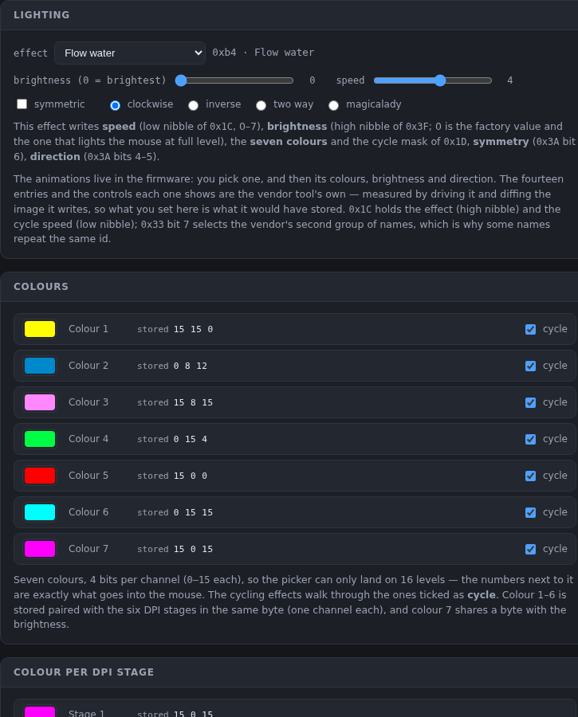

# Configurador libre del ratón HXSJ S700 «G6» — sin drivers, en Linux, Windows o el navegador

[](LICENSE)


[](https://github.com/Jo3l/s700-mouse-configurator/releases/latest)
[](https://github.com/Jo3l/s700-mouse-configurator/releases)

**Read this in English: [README.en.md](README.en.md)**

## Descargar y usar en un minuto

| Quiero… | Cómo |
|---|---|
| **usarlo sin descargar nada** | **<https://jo3l.github.io/s700-mouse-configurator/>** — la herramienta servida, con WebHID; abre la página y pulsa *Connect mouse* |
| **Windows** | [`s700-host-windows-x86_64.exe`](https://github.com/Jo3l/s700-mouse-configurator/releases/latest) — doble clic, abre la interfaz en `127.0.0.1:8760` y habla con el ratón él mismo; sin permisos ni instalador |
| **Linux** | [`s700-host-linux-x86_64`](https://github.com/Jo3l/s700-mouse-configurator/releases/latest) + `99-s700-hid.rules` (una vez: `sudo cp 99-s700-hid.rules /etc/udev/rules.d/ && sudo udevadm control --reload-rules`) |
| **un solo fichero HTML** | `S700-configurator.html` de la release: se abre con doble clic en Chrome/Edge/Brave, sin servidor |

Los binarios los compila GitHub Actions al publicar cada versión
([`.github/workflows/release.yml`](.github/workflows/release.yml)), y la web se
publica sola en GitHub Pages desde `main`
([`.github/workflows/pages.yml`](.github/workflows/pages.yml)). Antes de escribir en el
ratón, haz una copia en la pestaña *Backup*.

Configurador **libre, sin drivers y sin instalar nada** para el ratón gaming
**HXSJ S700** — el que se vende también como **«G6»** o *S700 Gaming Mouse*, y que
solo trae una herramienta para Windows de 2016 (`S700 Gaming Mouse.exe`, MFC + GDI+,
sin firma). Remapea los **10 botones**, ajusta las **6 etapas de DPI**, crea
**macros**, cambia la **iluminación RGB**, gestiona los **4 perfiles** y guarda
**copias de seguridad** — desde **Linux**, **Windows** o **cualquier navegador
Chromium**, sin el software del fabricante y sin controladores.

El ratón guarda su configuración en memoria propia y habla **informes HID feature**,
así que la herramienta puede ser una página web. Este repositorio es el protocolo
descifrado, un configurador web (WebHID), un host nativo en Rust y las pruebas que
comparan byte a byte con lo que escribe el programa original.


## Qué se puede cambiar

| | |
|---|---|
| **Botones** | los 10 (izquierdo, derecho, rueda, laterales, rueda inclinada, botón de DPI) → 20 acciones: botón, tecla, multimedia, macro, DPI loop, LED loop, autofire, atajos |
| **DPI** | 6 etapas, hasta 6 colores distintos de LED, un color por etapa |
| **Iluminación** | los 4 efectos que trae el firmware (ids 8–11), brillo, 7 colores de usuario, 6 colores por etapa y máscara del ciclo |
| **Macros** | nombre + pasos (tecla y retardo), hasta 16 pasos en memoria, asignables a un botón |
| **Perfiles** | 4 perfiles de botones, con el activo a golpe de botón |
| **Backup** | exportar/importar la configuración completa en un JSON; la imagen de fábrica va incluida |
| **Guardado** | todo cambio se guarda solo en el navegador; al ratón solo se escribe cuando pulsas **Apply** |



## Tres formas de usar el mismo proyecto

La interfaz es **la misma** en las tres; no hay código duplicado.

| | Permisos | Qué necesitas | Tamaño |
|---|---|---|---|
| **Página web** (`make serve` + Chrome) | diálogo de WebHID por origen + regla udev en Linux | un navegador Chromium | 0 |
| **Un solo fichero HTML** (`make build`) | lo mismo (se abre como `file://`) | un navegador Chromium | ~520 KB |
| **Host nativo** (`make native`) | **nada en Windows**; regla udev en Linux | nada instalado | ~820 KB |

El host nativo (`native/`) es un ejecutable de Rust sin dependencias que lleva la UI
dentro, la sirve en `127.0.0.1` y habla el HID él mismo: no hay WebHID, ni diálogo
de permisos del navegador, ni instalador. En Windows es donde más se nota — allí no
hay que conceder nada.

## Empezar

### Windows

```powershell
# con el host nativo (recomendado): sin permisos de nada
s700-host.exe            # abre el navegador en http://127.0.0.1:8760/
```

o coge `dist/S700-configurador.html`, ábrelo con doble clic en Chrome/Edge/Brave y
pulsa **Connect mouse**. Cierra antes la herramienta del fabricante y su bandeja: la
abren en exclusiva y el ratón no se deja.

### Linux

```bash
sudo cp native/99-s700-hid.rules /etc/udev/rules.d/     # una vez
sudo udevadm control --reload-rules && sudo udevadm trigger

make native && ./native/target/release/s700-host          # o: make native-run
./native/target/release/s700-host --list                  # ¿ve el ratón?
```

El nodo `/dev/hidraw*` es `0600 root:root` en el kernel: eso lo necesitas igual con
el navegador, no es cosa de esta herramienta.

### Navegador, sin instalar nada

```bash
make build       # genera dist/S700-configurador.html
make serve       # o servir la versión con módulos en http://localhost:8099/web/
```

Solo navegadores con **WebHID**: Chrome, Edge, Brave, Opera, Vivaldi o Arc.
Firefox y Safari no lo implementan.

### macOS

La página web funciona en Chrome (WebHID); el host nativo aún no está portado.

## Compatibilidad

* **HXSJ S700 con cable** — `VID:PID 30FA:1540`, informe feature **id 7 de 64 bytes**,
  colección vendor `0xFF00/0x01`. Es la unidad con la que se ha medido todo.
* El ratón solo escribe: **no contesta a `GetFeature`** (`docs/PROTOCOL.md` §4), así
  que la configuración de partida es la imagen de fábrica leída del software original.
* Sin probar: la variante inalámbrica, otras revisiones de firmware del mismo modelo.
  Si tu unidad no aparece, `--list` y el panel *Debug* dicen qué se ve.

## Preguntas frecuentes

**¿Funciona sin el programa del fabricante?** Sí: es exactamente lo que hace. No
hace falta instalarlo, ni Wine, ni Windows.

**¿Necesito permisos de administrador?** En Windows no. En Linux hay que dar acceso
al nodo del kernel una vez (regla udev incluida); sin eso no hay forma, ni con
navegador ni con binario.

**¿Puede dejar el ratón inservible?** No hay caso conocido: la configuración es
memoria flash aparte del firmware. Aun así, **haz una copia antes** (pestaña
*Backup*) y ten a mano la herramienta del fabricante; volver a escribir una
configuración conocida lo deja como estaba.

**¿Por qué solo hay 4 efectos de luz si la herramienta del fabricante lista 14?**
Porque el firmware implementa cuatro (ids 8–11) y la lista del fabricante es genérica:
repite nombres y los apunta a ids que no existen. Medido entrada por entrada, y luego
mirado en el ratón: 8 parpadea, 9 deja el color fijo, 10 respira (con sus propios
colores) y 11 recorre la tira; 12–15 no encienden nada. Los nombres de la herramienta
no describen el hardware (`docs/PROTOCOL.md` §5-quater).

**¿Cómo se averiguó el protocolo?** Ingeniería inversa del `.exe` y captura del
tráfico HID real, ejecutando la herramienta original bajo Wine con una DLL que
suplanta `HID/SetupAPI`. Todo el arnés está en `tools/`.

**¿Hace falta internet?** No: ninguna de las tres formas sale de tu equipo.

**¿Y el teclado/software propio del ratón (autofire, DPI loop)?** Las 20 acciones del
firmware están soportadas; son las que trae el propio ratón.

## Documentación

* **[docs/PROTOCOL.md](docs/PROTOCOL.md)** — protocolo y mapa de memoria, con lo
  verificado y lo que falta.
* **[docs/NATIVE.md](docs/NATIVE.md)** — el host nativo: cómo encaja, permisos,
  compilación y qué queda por probar.

## Estado

| Pieza | Estado |
|---|---|
| Protocolo (tramas, comandos, bloques de escritura) | verificado contra el programa original |
| Mapa de botones y perfiles | verificado byte a byte |
| Tabla de acciones (1–20) | verificada |
| DPI (empaquetado en nibbles) | verificado; la correspondencia con el DPI real está pendiente |
| LED | **descifrado**: 4 efectos (ids 8–11; 12–15 no encienden, 0–7 sin medir), brillo (`0x3F`), 7 colores de usuario y 6 de etapa (`0x20–0x31`, 4 bits por canal con el **nivel invertido**), máscara del ciclo (`0x1D`). Simetría y dirección (`0x3A`) **sin confirmar**: no se les ha visto efecto |
| Tiempos y registros de macros | parcialmente verificado |
| Lectura (`GetFeature`) | probada en hardware y no devuelve el protocolo: la base es la imagen de fábrica |
| Tamaño de informe (64 bytes de datos) | confirmado en el ratón real |
| Escritura | siempre la **imagen completa** (108 bloques), como el fabricante; escribir solo los bloques tocados hace que el ratón descarte el cambio |
| Host nativo | Linux compilado y probado hasta la escritura (bloqueada por permisos del nodo); `.exe` de Windows compilado, **sin probar en Windows** |
| CLI de Python | funciona contra backups; falta probar con el ratón real |

## Cómo habla el ratón (resumen)

```
informe feature id 7, 64 bytes de datos (colección 0xFF01)
18 <cmd> <idx> <addr_lo> <addr_hi> <dato> <len-1> ...

cmd 03 = escribir byte (idx = posición)   cmd 05 = leer byte
cmd 09 = confirmar bloque en <addr>       cmd 00 = fin   cmd 10 = fin de sesión
```

El programa del fabricante sube la configuración en bloques de 8 bytes y usa **solo**
`HidD_SetFeature`/`HidD_GetFeature`. Detalle completo en
[docs/PROTOCOL.md](docs/PROTOCOL.md).

## CLI de backup y ajustes

```bash
pip install hidapi
python tools/g6cli.py list
python tools/g6cli.py dump mi-raton.json     # copia + resumen (root en Linux)
python tools/g6cli.py show mi-raton.json
python tools/g6cli.py set-key 8 20           # botón 8 -> acción 20
python tools/g6cli.py set-profile 2
python tools/g6cli.py restore mi-raton.json
```

## Desarrollo

```bash
make serve     # http://localhost:8099/web/index.html
make build     # dist/S700-configurador.html (un solo fichero, para file://)
make native    # native/target/release/s700-host
make test      # 178 comprobaciones
```

Las pruebas reproducen bytes capturados del programa original
(`tools/probe/baseline.log`), así que si el ratón cambia de protocolo lo detectan.
Para probar la interfaz sin hardware está `tools/mock_hid.js` (ratón simulado).

## Estructura

```
dist/                S700-configurador.html — un solo fichero, doble clic
docs/PROTOCOL.md     protocolo y mapa de memoria
docs/NATIVE.md       host nativo: diseño, permisos y compilación
web/                 configurador WebHID (g6.js protocolo, core.js lógica, app.js UI)
web/bridge.js        enchufe que sustituye navigator.hid cuando sirve el host nativo
native/              host nativo en Rust, sin dependencias: UI + HID en un ejecutable
tools/g6proto.py     implementación de referencia del protocolo (Python)
tools/g6cli.py       CLI de backup y ajustes
tools/build.py       empaqueta web/ en dist/ (sin módulos ES, para file://)
tools/mock_hid.js    ratón simulado para probar la web sin hardware
tools/hid_shim.c     DLL que suplanta HID/SetupAPI para capturar el tráfico bajo Wine
tools/probe/         arnés de ingeniería inversa y logs capturados
tools/test_*         pruebas (reproducen el tráfico real del fabricante)
```

## Aviso

Proyecto de ingeniería inversa con fines de **interoperabilidad**. No está afiliado
a HXSJ ni a ninguna marca; el software del fabricante no se distribuye aquí. Escribir
en la memoria del ratón puede dejarlo en un estado raro (se recupera volviendo a
escribir una configuración conocida o con el programa del fabricante). Usa el backup.

## Licencia

[MIT](LICENSE).
