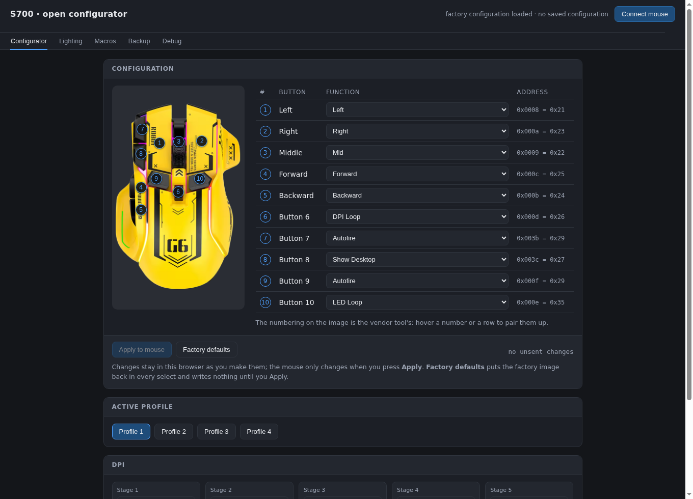

# Open-source configurator for the HXSJ S700 «G6» gaming mouse — no drivers, on Linux, Windows or in your browser

[](LICENSE)


[](https://github.com/Jo3l/s700-mouse-configurator/releases/latest)
[](https://github.com/Jo3l/s700-mouse-configurator/releases)

**Leer en español: [README.es.md](README.es.md)**

## Download and run in a minute

| I want to… | How |
|---|---|
| **use it without downloading anything** | **<https://jo3l.github.io/s700-mouse-configurator/>** — the tool served as a web page (WebHID); open it and press *Connect mouse* |
| **Windows** | [`s700-host-windows-x86_64.exe`](https://github.com/Jo3l/s700-mouse-configurator/releases/latest) — double click and that is it: it opens your browser with the UI already loaded and talks to the mouse itself; no permissions, no installer |
| **Linux** | [`s700-host-linux-x86_64`](https://github.com/Jo3l/s700-mouse-configurator/releases/latest) — run it; if it cannot open the mouse it offers to install the udev rule and asks for your password once |
| **a single HTML file** | `S700-configurator.html` from the release: double click it in Chrome/Edge/Brave, no server needed |

The binaries are built by GitHub Actions on every release
([`.github/workflows/release.yml`](.github/workflows/release.yml)) and the web page is
published to GitHub Pages from `main`
([`.github/workflows/pages.yml`](.github/workflows/pages.yml)). Back up from the
*Backup* tab before writing to the mouse.

Free, **driver-free, install-nothing** configurator for the **HXSJ S700** gaming
mouse (also sold as **«G6»** or *S700 Gaming Mouse*), a cheap 10-button wired mouse
that only ships a 2016 Windows-only MFC tool (`S700 Gaming Mouse.exe`, unsigned, no
source). Remap the **10 buttons**, set the **6 DPI stages**, build **macros**, change
the **RGB lighting**, manage the **4 profiles** and keep **backups** — from **Linux**,
**Windows** or **any Chromium browser**, without the vendor software and without
installing a driver.

The mouse stores its configuration in its own flash and speaks **HID feature
reports**, so the tool can be a web page. This repository is the reverse-engineered
protocol, a WebHID configurator, a native Rust host and the tests that compare
everything byte for byte against what the vendor tool writes.



## What you can change

| | |
|---|---|
| **Buttons** | all 10 (left, right, wheel, side, wheel tilt, DPI button) → 20 actions: mouse button, key, media key, macro, DPI loop, LED loop, autofire, shortcuts |
| **DPI** | 6 stages, up to 6 different LED colours, one per stage |
| **Lighting** | the vendor tool's **14 effects**, each with the controls it really shows (speed, brightness, 7 colours + cycle ticks, symmetry, up to 4 directions), 6 per-stage colours (independent of the effect), and **one animation per button** for *Button response* |
| **Macros** | name + steps (key and delay), up to 16 steps in memory, assignable to a button |
| **Profiles** | 4 button profiles, active one switchable from a button |
| **Backup** | export/import the whole configuration as JSON; the factory image ships with the tool |
| **Saving** | every change is saved in the browser; the mouse only changes when you press **Apply** |


## Three ways to run the same project

The interface is **identical** in all three; no code is duplicated.

| | Permissions | What you need | Size |
|---|---|---|---|
| **Web page** (`make serve` + Chrome) | WebHID permission per origin + udev rule on Linux | a Chromium browser | 0 |
| **Single HTML file** (`make build`) | same (it opens as `file://`) | a Chromium browser | ~520 KB |
| **Native host** (`make native`) | **nothing on Windows**; udev rule on Linux | nothing installed | ~820 KB |

The native host (`native/`) is a dependency-free Rust binary that embeds the UI,
serves it on `127.0.0.1` and talks to the HID device itself: no WebHID, no browser
permission dialog, no installer. Windows is where it pays off most — there is
nothing to grant.

## Quick start

### Windows

```powershell
s700-host.exe            # double click: opens your browser with the UI loaded
```

or grab `dist/S700-configurador.html`, double-click it in Chrome/Edge/Brave and press
**Connect mouse**. Close the vendor tool and its tray helper first: they hold the
device exclusively.

### Linux

```bash
make native && ./native/target/release/s700-host          # or: make native-run
./native/target/release/s700-host --list                  # does it see the mouse?
./native/target/release/s700-host --install-rule           # only if it cannot open it
```

`/dev/hidraw*` is `0600 root:root` in the kernel, so someone has to grant access —
the browser needs it too. The binary does not ask you to copy anything: if it cannot
open the mouse it says so and offers to install the rule, either from the *Debug* tab
(**Install udev rule**) or with `--install-rule`. Either way your desktop asks for
your password once (`pkexec`) and from then on everything runs as your normal user.

What it deliberately does **not** do is run the server as root: that would work
without any rule, but it would leave a local HTTP server with device access running
as root. A udev rule scoped to one VID:PID is a much smaller door.

### Browser only

```bash
make build       # builds dist/S700-configurador.html
make serve       # or serve the modular version at http://localhost:8099/web/
```

Chromium only: Chrome, Edge, Brave, Opera, Vivaldi or Arc. Firefox and Safari do not
implement WebHID.

### macOS

The web page works in Chrome (WebHID); the native host has not been ported yet.

## Compatibility

* **HXSJ S700 wired** — `VID:PID 30FA:1540`, **feature report id 7, 64 bytes**, vendor
  collection `0xFF00/0x01`. That is the unit everything was measured on.
* The mouse is **write-only**: it does not answer `GetFeature` (`docs/PROTOCOL.md` §4),
  so the starting point is the factory image read out of the vendor tool.
* Not tested: the wireless variant, other firmware revisions of the same model. If
  your unit does not show up, `--list` and the *Debug* panel tell you what is seen.

## FAQ

**Does it work without the vendor software?** Yes — that is the whole point. No
vendor tool, no Wine, no Windows needed.

**Do I need administrator rights?** Not on Windows. On Linux you grant access to the
kernel node once (udev rule included); nothing can talk to the mouse without it.

**Can it brick the mouse?** No case is known: the configuration is flash separate
from the firmware. Still, **back up first** (*Backup* tab) and keep the vendor tool
around; writing a known configuration back always recovers it.

**Do all 14 lighting effects exist?** Yes, and the tool's list is honest after all. Driven
entry by entry, it writes 14 different settings: ids 8–15 for the first eight names, the
same ids 8–11 again but with bit 7 of `0x33` set for the second group (Flicker, Star Trek,
Water, enraptured), id 9 with a cycle nibble of 12 for *Button response* and of 7 for
*Mute*. What we have **not** done is watch every one of them on the LED: the ids of the
factory configuration (Star Trek, i.e. 9 + that bit) are the measured ones — 8 blinks, 9
holds a colour, 10 breathes, 11 chases — and 12–15 lit nothing with that byte. The
configurator offers all fourteen with the options the vendor shows, and the Debug tab's
byte probe is the way to check the rest (`docs/PROTOCOL.md` §5-quater).

**How was the protocol found?** Reverse engineering of the `.exe` plus capturing the
real HID traffic by running the vendor tool under Wine with a DLL that impersonates
`HID/SetupAPI`. The whole harness is in `tools/`.

**Does it need internet?** No. None of the three ways leaves your machine.

## Documentation

* **[docs/PROTOCOL.md](docs/PROTOCOL.md)** — protocol and memory map, with what is
  verified and what is not (Spanish version: `docs/PROTOCOL.es.md`).
* **[docs/NATIVE.md](docs/NATIVE.md)** — the native host: how it fits, permissions,
  building it and what is still unproven.
* Spanish README: **[README.es.md](README.es.md)**.

## Status

| Piece | State |
|---|---|
| Protocol (frames, commands, write blocks) | verified against the vendor tool |
| Button map and profiles | verified byte by byte |
| Action table (1–20) | verified |
| DPI (nibble packing) | verified; real DPI values still unconfirmed |
| LED | **decoded**: the 14 effects of the vendor list (id in `0x1C`, second group in `0x33` bit 7, *Button response*/*Mute* in the cycle nibble), the options each one writes (speed `0x1C`, brightness `0x3F`, 7 colours + mask `0x1D`/`0x20–0x31`, symmetry and 4 directions in `0x3A`), 4-bit channels with an **inverted level**, and the **per-button animation** in bits 7–6 of each button's action byte. Seen on hardware: the factory ids only; whether symmetry/direction change the animation is still **unconfirmed** |
| Macro timing and records | partially verified |
| Reading (`GetFeature`) | tried on hardware, it does not return the protocol: the base is the factory image |
| Report size (64 data bytes) | confirmed on the real mouse |
| Writing | always the **whole image** (108 blocks), like the vendor; writing only the touched blocks makes the mouse drop the change |
| Native host | Linux built and tested up to the write (blocked by node permissions); the Windows `.exe` builds but is **untested on Windows** |
| Python CLI | works against backups; not yet tried on the real mouse |

## How the mouse talks (summary)

```
feature report id 7, 64 data bytes (0xFF01 collection)
18 <cmd> <idx> <addr_lo> <addr_hi> <data> <len-1> ...

cmd 03 = write byte (idx = position)   cmd 05 = read byte
cmd 09 = commit block at <addr>        cmd 00 = end   cmd 10 = end of session
```

The vendor tool uploads the configuration in 8-byte blocks and uses **only**
`HidD_SetFeature`/`HidD_GetFeature`. Full detail in
[docs/PROTOCOL.md](docs/PROTOCOL.md).

## Backup CLI

```bash
pip install hidapi
python tools/g6cli.py list
python tools/g6cli.py dump my-mouse.json     # backup + summary (root on Linux)
python tools/g6cli.py show my-mouse.json
python tools/g6cli.py set-key 8 20           # button 8 -> action 20
python tools/g6cli.py set-profile 2
python tools/g6cli.py restore my-mouse.json
```

## Development

```bash
make serve     # http://localhost:8099/web/index.html
make build     # dist/S700-configurador.html (single file, for file://)
make native    # native/target/release/s700-host
make test      # 178 assertions
```

The tests replay bytes captured from the vendor tool (`tools/probe/baseline.log`), so
a protocol change shows up immediately. `tools/mock_hid.js` is a simulated mouse for
working on the UI without hardware.

## Layout

```
dist/                S700-configurador.html — one file, double click
docs/PROTOCOL.md     protocol and memory map
docs/NATIVE.md       native host: design, permissions, build
web/                 WebHID configurator (g6.js protocol, core.js logic, app.js UI)
web/bridge.js        shim that replaces navigator.hid when the native host serves it
native/              Rust host, no dependencies: UI + HID in one executable
tools/g6proto.py     reference implementation of the protocol (Python)
tools/g6cli.py       backup and settings CLI
tools/build.py       bundles web/ into dist/ (no ES modules, for file://)
tools/mock_hid.js    simulated mouse for UI work without hardware
tools/hid_shim.c     DLL that impersonates HID/SetupAPI to capture traffic under Wine
tools/probe/         reverse-engineering harness and captured logs
tools/test_*         tests (they replay the vendor tool's real traffic)
```

## Disclaimer

Reverse-engineering project for **interoperability**. Not affiliated with HXSJ or any
brand; the vendor software is not distributed here. Writing to the mouse's memory can
leave it in an odd state (writing back a known configuration, or the vendor tool,
recovers it). Keep a backup.

## License

[MIT](LICENSE).
